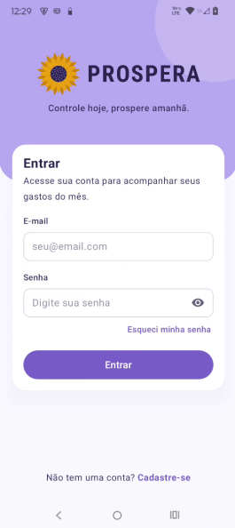
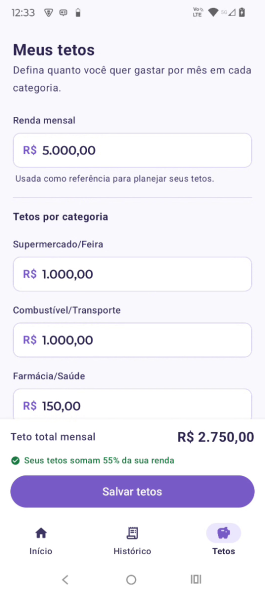
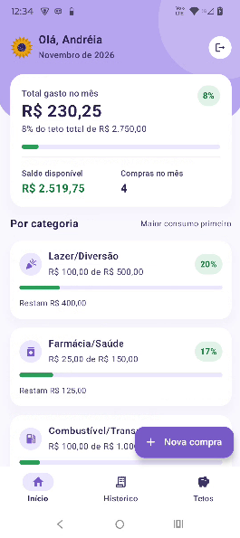
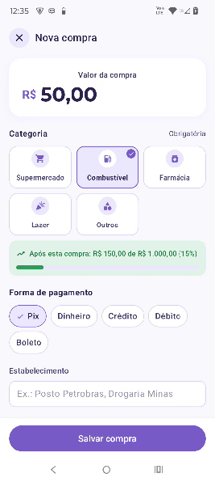
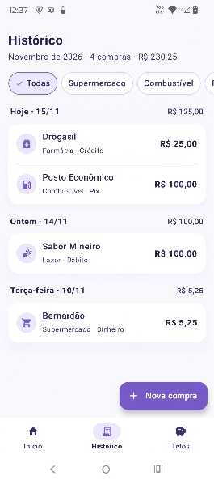
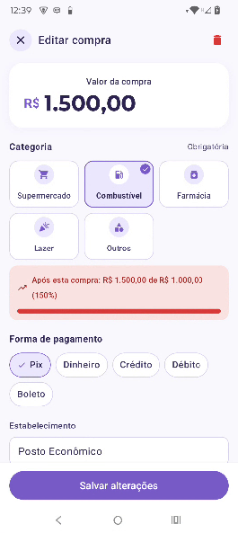
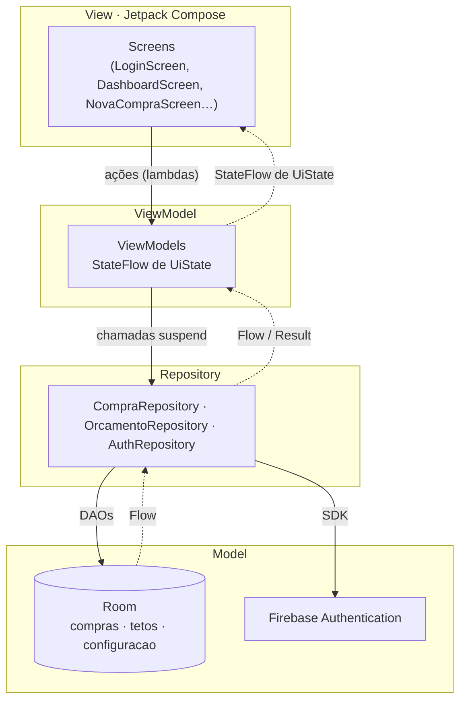

# 🌻 PROSPERA

**Controle hoje, prospere amanhã.**

PROSPERA é um app Android para controlar gastos mensais por categoria. Você define um teto para cada categoria, registra suas compras em poucos toques e acompanha, com cores, o quanto já consumiu de cada teto.

Programação para Dispositivos Móveis — IFTM

> **[Protótipo no Figma](https://www.figma.com/design/zubyEig03VSs89a2YvkVFl/prospera-app?node-id=0-1&t=hdLnPxOMcycf1PEd-1)**

---

## Sumário

- [Funcionalidades](#-funcionalidades)
- [Capturas de tela](#-capturas-de-tela)
- [Prototipagem](#-prototipagem)
- [Arquitetura MVVM](#-arquitetura-mvvm)
- [Modelo de dados](#-modelo-de-dados)
- [Regras de negócio e validações](#-regras-de-negócio-e-validações)
- [Decisões de projeto](#-decisões-de-projeto)
- [Tecnologias](#-tecnologias)
- [Como executar](#-como-executar)
- [Testes](#-testes)
- [Histórico de commits](#-histórico-de-commits)
- [Melhorias futuras](#-melhorias-futuras)
- [Autoria](#-autoria)

---

## ✅ Funcionalidades

### 1. Teto por categoria

Na tela **Tetos** você define quanto pode gastar por mês em cada uma das cinco categorias: **Supermercado/Feira**, **Combustível/Transporte**, **Farmácia/Saúde**, **Lazer/Diversão** e **Outros**. No primeiro acesso, depois do cadastro, essa tela aparece antes do Dashboard. Depois, ela fica disponível na aba **Tetos** da barra inferior. O rodapé mostra o teto total mensal, que é a soma dos tetos das categorias.

### 2. Lançamento rápido de compras

O botão **Nova compra** fica no Dashboard e no Histórico. Ele abre uma tela única em que o campo de valor já recebe o foco com o teclado numérico aberto. Você escolhe a categoria numa grade de ícones e a forma de pagamento em chips (Pix, Dinheiro, Crédito, Débito ou Boleto), depois informa o estabelecimento e a data. A data começa em hoje e pode ser trocada por um calendário. Antes de salvar, uma **prévia do teto** mostra como a categoria vai ficar depois da compra, por exemplo: "Após esta compra: R$ 1.118,70 de R$ 1.200,00 (93%)".

### 3. Painel visual em tempo real com alerta verde → amarelo → vermelho

O Dashboard mostra um card por categoria com o valor gasto, o teto, o percentual, uma barra de progresso e uma mensagem. Os cards vêm ordenados do maior para o menor consumo, e a cor segue o percentual do teto:

| Faixa | Status | Cor | Mensagem |
|---|---|---|---|
| abaixo de 70% | OK | verde | "Restam R$ …" |
| de 70% até abaixo de 100% | Atenção | amarelo | "Atenção: restam R$ …" |
| 100% ou mais | Estourado | vermelho, com borda no card | "Teto estourado em R$ …" |

As consultas do Room são `Flow`. Por isso o painel se atualiza sozinho sempre que uma compra é criada, editada ou excluída, sem precisar recarregar a tela.

### 4. Resumo financeiro global com total e saldo

No topo do Dashboard, um card resume o mês atual com o **total gasto**, o percentual do **teto total**, uma barra de progresso com a mesma regra de cores, o **saldo disponível** (soma dos tetos − total gasto, em vermelho quando fica negativo) e a **quantidade de compras** do mês.

### 5. Validação e persistência

Todos os formulários são validados antes de salvar, com mensagens abaixo de cada campo (veja [Regras de negócio e validações](#-regras-de-negócio-e-validações)). O botão de salvar fica sempre habilitado. Os erros aparecem ao tentar salvar e, a partir daí, são reavaliados a cada alteração. Os dados ficam no banco local **Room** e continuam lá depois que o app é fechado. Como o estado dos formulários fica nos ViewModels, nada se perde ao girar a tela.

### Autenticação, edição e exclusão de compras e renda mensal

- **Autenticação:** cadastro com nome, e-mail, senha e confirmação de senha, login com e-mail e senha e **Esqueci minha senha**, que envia um link de redefinição para o e-mail informado. Tudo usa o **Firebase Authentication**. O app lembra a sessão e abre direto no Dashboard, ou na tela de Tetos se o primeiro acesso ainda não foi concluído. O botão de sair fica no Dashboard.
- **Histórico:** compras do mês atual agrupadas por dia ("Hoje · 04/11", "Ontem · 03/11", "Segunda-feira · 02/11"), com total por dia e filtro por categoria.
- **Edição e exclusão:** tocar numa compra do Histórico abre a tela **Editar compra** com os dados preenchidos. A lixeira pede confirmação ("Excluir esta compra?") antes de excluir. Ao voltar, o Dashboard ou o Histórico mostram um aviso ("Compra registrada", "Compra atualizada" ou "Compra excluída").
- **Renda mensal:** é obrigatória na tela de Tetos e serve de referência para o planejamento. O app mostra quanto da renda os tetos somam (por exemplo, "Seus tetos somam 85% da sua renda").

---

## 📱 Capturas de tela

| Login | Cadastro | Tetos |
|:---:|:---:|:---:|
|  |  |  |
| **Dashboard** | **Nova compra** | **Histórico** |
|  |  |  |
| **Editar compra** | | |
|  | | |

---

## 🎨 Prototipagem

O protótipo das telas foi feito no Figma: **[abrir o protótipo](https://www.figma.com/design/zubyEig03VSs89a2YvkVFl/prospera-app?node-id=0-1&t=hdLnPxOMcycf1PEd-1)**.

**Paleta de cores**

| Papel | Cor |
|---|---|
| Primária | `#7A5CC9` |
| Lilás | `#B9A6F2` |
| Container | `#EDE7FF` |
| Fundo | `#FAF8FF` |
| Ameixa (texto principal) | `#2E2350` |
| Status OK | `#2E9E5B` (verde) |
| Status Atenção | `#F2C200` (amarelo) |
| Status Estourado | `#D93B3B` (vermelho) |

**Tipografia:** Roboto nos textos da interface e Roboto Condensed (negrito) no nome da marca, carregada pelo Google Fonts com a fonte condensada do sistema como alternativa.

**Identidade:** o girassol é o símbolo do app. Ele aparece no logotipo, nas telas de entrada, no Dashboard e no ícone do app, sobre fundo `#7A5CC9`.

---

## 🧱 Arquitetura MVVM

O app segue o padrão **MVVM** com fluxo de dados unidirecional:

- **View (Jetpack Compose):** as telas (`*Screen`) recebem um `UiState` e lambdas para as ações. Elas não acessam repositórios e coletam o estado com `collectAsStateWithLifecycle`.
- **ViewModel:** cada tela tem um ViewModel que expõe um `StateFlow<UiState>` e funções para as ações (`salvar()`, `selecionarCategoria()`, `excluir()` …). É nele que ficam a validação, os cálculos e o estado dos formulários.
- **Repository:** `CompraRepository`, `OrcamentoRepository` (tetos e configuração) e `AuthRepository` escondem a origem dos dados e devolvem modelos de domínio, com `Flow` para as consultas observáveis.
- **Model:** o modelo de domínio (`Compra`, `Categoria`, `FormaPagamento`, `StatusConsumo` …) e as fontes de dados, que são o **Room** (entidades e DAOs) para as compras, os tetos e a configuração e o **Firebase Authentication** para a conta do usuário.

As dependências são criadas manualmente no `AppContainer` (pacote `di`) e entregues aos ViewModels por uma `ViewModelProvider.Factory`.



As ações descem da tela para o banco (setas contínuas) e os dados sobem por `Flow` até a tela (setas tracejadas).

**Estrutura de pacotes** (`app/src/main/java/com/apccarvalho/prospera`)

```text
com.apccarvalho.prospera
├── MainActivity.kt
├── ProsperaApp.kt
├── data
│   ├── local
│   │   ├── Converters.kt
│   │   ├── ProsperaDatabase.kt
│   │   ├── dao          (CompraDao, TetoDao, ConfiguracaoDao)
│   │   └── entity       (CompraEntity, TetoEntity, ConfiguracaoEntity)
│   └── repository       (AuthRepository, CompraRepository, OrcamentoRepository)
├── di                   (AppContainer)
├── domain
│   ├── model            (Categoria, Compra, Configuracao, FormaPagamento, ResumoCategoria, StatusConsumo)
│   └── util             (Dinheiro, Periodo, ResumoMensal, Validadores)
└── ui
    ├── ProsperaViewModelFactory.kt
    ├── auth             (LoginScreen, CadastroScreen e seus ViewModels)
    ├── components       (BarraProgresso, BotaoPrimario, BottomNav, CampoData, CampoTexto,
    │                     CampoValor, CardCategoria, ChipOpcao, OpcaoCategoria …)
    ├── compra           (NovaCompraScreen, NovaCompraViewModel)
    ├── dashboard        (DashboardScreen, DashboardViewModel)
    ├── historico        (HistoricoScreen, HistoricoViewModel)
    ├── navigation       (ProsperaNavHost, Rotas, InicioViewModel)
    ├── tetos            (TetosScreen, TetosViewModel)
    └── theme            (Color, Theme, Type)
```

**Telas e ViewModels**

| Tela | ViewModel | Responsabilidade |
|---|---|---|
| Inicial (rota `inicio`) | `InicioViewModel` | Decide a primeira tela: Login, Tetos (primeiro acesso) ou Dashboard |
| `LoginScreen` | `LoginViewModel` | Login e "Esqueci minha senha" |
| `CadastroScreen` | `CadastroViewModel` | Criação de conta |
| `TetosScreen` | `TetosViewModel` | Renda mensal e tetos por categoria |
| `DashboardScreen` | `DashboardViewModel` | Resumo do mês e cards por categoria |
| `NovaCompraScreen` | `NovaCompraViewModel` | Criação e edição de compra, prévia do teto e exclusão |
| `HistoricoScreen` | `HistoricoViewModel` | Compras do mês agrupadas por dia, com filtro |

---

## 💾 Modelo de dados

O banco Room (`prospera.db`) tem três tabelas. Todas têm `userId`, o identificador do usuário no Firebase, para que cada conta veja apenas os próprios dados.

**`compras`** (índice em `userId` + `data`)

| Campo | Tipo | Descrição |
|---|---|---|
| `id` | `Long` (chave primária, autoincremento) | Identificador da compra |
| `userId` | `String` | Dono da compra |
| `valorCentavos` | `Long` | Valor em centavos |
| `categoria` | `Categoria` (gravada como texto) | `SUPERMERCADO`, `COMBUSTIVEL`, `FARMACIA`, `LAZER` ou `OUTROS` |
| `estabelecimento` | `String` | Nome do local, sem espaços nas pontas |
| `formaPagamento` | `FormaPagamento` (gravada como texto) | `PIX`, `DINHEIRO`, `CREDITO`, `DEBITO` ou `BOLETO` |
| `data` | `LocalDate` (gravada como `Long`, dias desde 1970-01-01) | Dia da compra |
| `criadoEm` | `Long` (milissegundos) | Momento do registro, usado para desempatar a ordem no mesmo dia |

**`tetos`** (chave primária composta `userId` + `categoria`)

| Campo | Tipo | Descrição |
|---|---|---|
| `userId` | `String` | Dono do teto |
| `categoria` | `Categoria` (gravada como texto) | Categoria do teto |
| `valorCentavos` | `Long` | Teto mensal em centavos |

**`configuracao`** (chave primária `userId`)

| Campo | Tipo | Descrição |
|---|---|---|
| `userId` | `String` | Dono da configuração |
| `rendaMensalCentavos` | `Long?` | Renda mensal em centavos |
| `onboardingConcluido` | `Boolean` | Indica se o primeiro acesso (definição dos tetos) foi concluído |

**Por que centavos em `Long`?** Tipos de ponto flutuante (`Double`, `Float`) não representam exatamente valores como 0,10. Somar muitas compras com eles acumula erros de arredondamento. Guardar o valor como número inteiro de centavos deixa somas, comparações com o teto e cálculo do saldo sempre exatos. A conversão para "R$ 1.188,70" só acontece na hora de exibir.

---

## 📏 Regras de negócio e validações

**Máscara monetária.** Os campos de valor usam a máscara de entrada da direita para a esquerda. Cada dígito digitado entra como o último centavo. Digitar 8, 5, 9 e 0 mostra 0,08 → 0,85 → 8,59 → 85,90. Apagar remove o último dígito. Ao colar um texto, apenas os dígitos são aproveitados. O valor máximo é **R$ 999.999,99**, e a digitação além dele é ignorada.

**Regras de cada campo**

| Campo | Regra | Mensagem |
|---|---|---|
| Valor da compra | maior que zero e até R$ 999.999,99 | "Informe um valor maior que zero" / "Valor acima do limite permitido" |
| Teto de cada categoria e renda mensal | mesmas regras do valor (obrigatórios) | "Informe um valor maior que zero" |
| Categoria | obrigatória | "Escolha uma categoria" |
| Forma de pagamento | obrigatória | "Escolha a forma de pagamento" |
| Estabelecimento | de 2 a 50 caracteres, sem contar espaços nas pontas | "Informe o estabelecimento" / "Use no máximo 50 caracteres" |
| Data | não pode ser futura (o calendário só permite datas até hoje) | "A data não pode ser futura" |
| Nome | não pode ficar em branco | "Informe seu nome" |
| E-mail | formato `usuario@dominio.ext` | "Informe um e-mail válido" |
| Senha | pelo menos 6 caracteres | "A senha deve ter pelo menos 6 caracteres" |
| Confirmação de senha | igual à senha | "As senhas não conferem" |

**Status de consumo.** O percentual de uma categoria é `gasto ÷ teto`. Até **70%** (exclusive), o status é **OK** (verde). De **70%** até abaixo de **100%**, é **Atenção** (amarelo). A partir de **100%**, é **Estourado** (vermelho). A mesma regra vale para o resumo global, usando o total gasto e a soma dos tetos.

**Prévia do teto.** Na Nova Compra, a prévia é o total já gasto na categoria no mês da data escolhida mais o valor digitado, comparado ao teto da categoria. Na edição, o valor original da compra é descontado quando ela já pertencia à mesma categoria e ao mesmo mês, para não ser contado duas vezes.

**Saldo.** `saldo = soma dos tetos de todas as categorias − total gasto no mês`. Ele pode ficar negativo, e então aparece em vermelho. A renda mensal não entra nesse cálculo.

---

## 🧭 Decisões de projeto

| Decisão | Motivo |
|---|---|
| Categoria **Lazer/Diversão** acrescentada | Separa gastos de lazer, que costumam ser os primeiros a cortar quando o orçamento aperta, de "Outros" |
| Teto também para **Outros** | Sem teto, "Outros" viraria um destino sem limite; com ele, todo gasto do mês fica sob controle |
| **Boleto** como forma de pagamento e **Crédito** separado de **Débito** | Boleto é comum em contas fixas, e separar crédito de débito mostra o que sai na hora e o que vai para a fatura |
| **Renda mensal obrigatória** como referência, sem alterar o saldo | Ajuda a planejar tetos compatíveis com a renda ("seus tetos somam X% da renda"), sem misturar renda com o controle de gastos |
| **Saldo = soma dos tetos − total gasto** | O saldo mostra quanto ainda cabe no orçamento planejado, que é o objetivo do app |
| **Tetos fixos para todos os meses** | Tetos costumam se repetir mês a mês; o usuário define uma vez e ajusta quando quiser na aba Tetos |
| **Valores em centavos** (`Long`) | Evita erros de arredondamento de ponto flutuante em somas e comparações |
| **Dados separados por usuário** | Todas as tabelas têm `userId` (do Firebase), então várias contas no mesmo aparelho não veem os dados umas das outras |
| **Edição e exclusão com confirmação** | Permite corrigir lançamentos errados; a exclusão pede confirmação porque não pode ser desfeita |
| **Só Room para persistência** | O app funciona offline e sem custo de servidor; o Firebase é usado apenas para autenticação |
| **Injeção de dependência manual** com `AppContainer` | Para um app deste tamanho, evita a complexidade de um framework (como Hilt) e deixa as dependências explícitas |
| **`google-services.json` fora do repositório** | O arquivo identifica o projeto Firebase da autora; ele está no `.gitignore`, e quem for executar usa o próprio |

---

## 🔧 Tecnologias

Versões definidas em [`gradle/libs.versions.toml`](gradle/libs.versions.toml):

- **Kotlin** 2.4.21
- **Android Gradle Plugin** 9.3.3 e **Gradle** 9.5.0
- **KSP** 2.3.13
- **Jetpack Compose** (BOM 2026.09.00) com **Material 3** e Material Icons Extended
- **AndroidX Core KTX** 1.19.1
- **Activity Compose** 1.13.0
- **Lifecycle** (ViewModel e runtime Compose) 2.11.0
- **Navigation Compose** 2.10.2
- **Room** 2.8.5
- **Kotlin Coroutines** 1.11.0
- **Firebase BoM** 35.1.0 (Firebase Authentication) e plugin **Google Services** 4.5.0
- **JUnit** 4.13.2

SDK: `minSdk` 26 (Android 8.0), `targetSdk` e `compileSdk` 37.

---

## 💻 Como executar

**Requisitos**

- Android Studio atualizado, com suporte ao Android Gradle Plugin 9.3
- JDK 17 ou superior (o Android Studio já inclui um)
- Emulador ou aparelho com **Android 8.0 (API 26) ou superior**

**1. Clonar o repositório**

```bash
git clone https://github.com/apccarvalho/prospera-app.git
cd prospera-app
```

**2. Configurar o Firebase**

O arquivo `google-services.json` não está no repositório. Para gerar o seu:

1. Acesse o [Firebase Console](https://console.firebase.google.com/) e crie um projeto.
2. Adicione um app **Android** com o nome do pacote **`com.apccarvalho.prospera_app`**. Esse é o `applicationId` definido em `app/build.gradle.kts`. O pacote do código é `com.apccarvalho.prospera`, mas o Firebase confere o `applicationId`.
3. Em **Authentication → Método de login**, ative **E-mail/senha**.
4. Baixe o `google-services.json` e coloque-o na pasta `app/` do projeto.

**3. Rodar**

Abra o projeto no Android Studio, espere a sincronização do Gradle e execute a configuração **app** num emulador ou aparelho. Pela linha de comando:

```bash
./gradlew assembleDebug
```

O APK é gerado em `app/build/outputs/apk/debug/`.

---

## 🧪 Testes

Os testes unitários ficam em `app/src/test` e usam JUnit, sem depender do Android. Para rodar:

```bash
./gradlew test
```

O que é coberto:

- **Dinheiro:** formatação de valores em dinheiro ("R$ 0,00", "R$ 1.188,70", "R$ 999.999,99") e a máscara de digitação (sequência de dígitos, apagar, colar texto com letras e símbolos e limite máximo).
- **Validadores:** todas as regras de validação dos formulários nos casos válido e inválido, incluindo os limites (valor 0, 1 e acima do máximo; estabelecimento com 1, 2, 50 e 51 caracteres e só com espaços; datas de hoje, ontem e amanhã; e-mails válidos e inválidos; senha com 5 e 6 caracteres; confirmação diferente).
- **StatusConsumo:** os limites de status de consumo, ou seja, verde abaixo de 70%, amarelo de 70% a 99,9% e vermelho a partir de 100%.

---

## 📜 Histórico de commits

Os commits seguem o padrão **[Conventional Commits](https://www.conventionalcommits.org/pt-br/)**, em que cada mensagem começa com um tipo que indica a natureza da mudança: `feat` (funcionalidade), `fix` (correção), `test` (testes), `docs` (documentação) e `chore` (configuração). O desenvolvimento foi dividido em 7 etapas:

1. **Configuração:** criação do projeto com Compose e version catalog, e configuração do Firebase.
2. **Fundação:** tema (cores, tipografia e ícones), enums, entidades, DAOs e banco Room, utilitários de dinheiro e validação, repositórios e `AppContainer`.
3. **Autenticação:** componentes de campo e botão, ViewModels e telas de login e cadastro, e navegação com rota inicial pelo estado de login.
4. **Tetos:** campo de valor com máscara monetária e tela de tetos com renda mensal e primeiro acesso.
5. **Dashboard:** barra de progresso e cards por categoria, resumo global, barra de navegação inferior e botão de nova compra.
6. **Compras:** Nova Compra com validação e prévia do teto, Histórico agrupado por dia com filtro, e edição e exclusão de compras.
7. **Entrega:** testes unitários, ajustes finais (ícone do app, acessibilidade e Lint) e este README.

---

## 🚀 Melhorias futuras

- **Compras recorrentes:** marcar compras como recorrentes para identificar os gastos fixos do mês.
- **Entradas de dinheiro:** registrar entradas, além das saídas, para acompanhar o fluxo completo.
- **Dica do mês com IA:** gerar uma dica personalizada com o Gemini via **Firebase AI Logic**, enviando apenas os totais por categoria, sem dados de estabelecimentos ou de compras individuais.

---

## 👤 Autoria

Desenvolvido por **Andréia Pereira de Carvalho**: [github.com/apccarvalho](https://github.com/apccarvalho)

Programação para Dispositivos Móveis — IFTM
